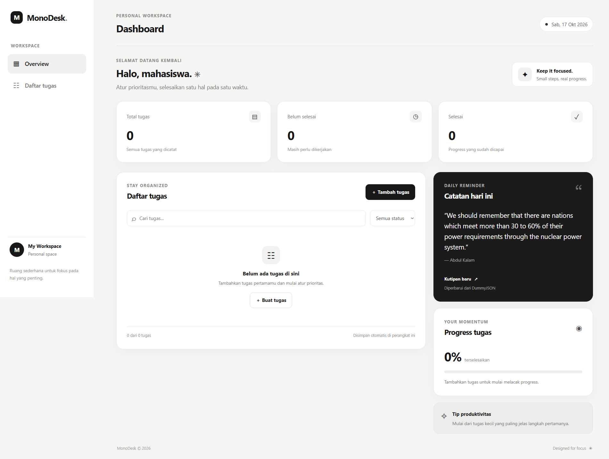

# MonoDesk — Personal Dashboard

MonoDesk adalah personal dashboard sederhana untuk membantu mahasiswa mengatur tugas kuliah dalam tampilan minimalis hitam-putih. Aplikasi dibuat menggunakan HTML, CSS, dan JavaScript murni tanpa framework.

## Fitur

- Tambah tugas dengan nama, mata kuliah/kategori, tenggat, dan prioritas.
- Edit dan hapus tugas.
- Tandai tugas selesai atau belum selesai.
- Cari tugas berdasarkan nama atau mata kuliah.
- Filter tugas berdasarkan status.
- Ringkasan jumlah tugas, tugas yang belum selesai, dan tugas selesai.
- Progress penyelesaian tugas dalam persentase.
- Kutipan motivasi acak dari DummyJSON API.
- Penyimpanan otomatis dengan `localStorage`; data tetap ada saat halaman dimuat ulang pada browser/perangkat yang sama.
- Tampilan responsif untuk desktop dan layar ponsel.
- Jika API kutipan tidak tersedia, aplikasi menampilkan kutipan bawaan.

## Struktur folder

```text
personal-dashboard/
├── index.html
├── css/
│   └── style.css
├── js/
│   └── app.js
└── README.md
```

## Implementasi ES6+

Nomor baris dapat berubah jika kode diedit. Rentang berikut merujuk ke file awal yang disertakan dalam ZIP.

| Fitur | Lokasi | Penjelasan |
|---|---|---|
| `const` | `js/app.js` baris 1–2, dan beberapa bagian lain | Untuk nilai yang referensinya tidak perlu ditetapkan ulang, seperti key penyimpanan dan URL API. |
| `let` | `js/app.js` tidak wajib digunakan | Aplikasi menggunakan `const` untuk deklarasi lokal karena tidak ada variabel lokal yang perlu di-assign ulang. `let` tidak harus dipaksakan jika tidak dibutuhkan. |
| Arrow functions | `js/app.js` sekitar baris 28–35, 37–43, 77, 100–103, dan lainnya | Callback untuk event listener, `map`, `filter`, dan pencarian elemen. |
| Template literals | `js/app.js` di `loadQuote()`, `handleSubmit()`, `render()`, `taskTemplate()`, dan lainnya | Menyisipkan data dinamis ke teks dan HTML menggunakan tanda backtick. |
| Async/await | `js/app.js`, method `async loadQuote()` | Memanggil API dengan `await fetch(...)`, lalu membaca respons dengan `await response.json()`. |
| Class | `js/app.js`, `class TaskItem` dan `class DashboardApp` | `TaskItem` memodelkan data tugas; `DashboardApp` mengatur state, UI, localStorage, event, dan API. |
| Destructuring | `js/app.js`, parameter `TaskItem`, `handleSubmit()`, `loadQuote()`, `render()`, dan `taskTemplate()` | Mengambil properti objek langsung ke variabel. |
| Spread operator | `js/app.js`, `handleSubmit()` dan `handleTaskToggle()` | `{ ...task, ... }` membuat objek baru saat memperbarui tugas. |
| Array methods | `js/app.js`, `loadTasks()`, `handleSubmit()`, `handleTaskToggle()`, `render()`, `renderTasks()` | Menggunakan `map()`, `filter()`, dan `find()` untuk mengelola data. |
| `fetch()` dan Promise | `js/app.js`, method `loadQuote()` | `fetch()` mengembalikan Promise; penanganan error dilakukan dengan `try/catch`. |
| `localStorage` | `js/app.js`, `loadTasks()` dan `saveTasks()` | Data tugas disimpan sebagai JSON dan dibaca kembali saat aplikasi dimulai. |

### Catatan tentang `let` dan `const`

Instruksi praktikum meminta penggunaan `let` dan `const` secara tepat. Dalam kode ini, deklarasi menggunakan `const` ketika variabel tidak perlu di-assign ulang. Properti `this.tasks` diperbarui saat state berubah. Tidak ada alasan untuk membuat variabel lokal `let` hanya demi memenuhi jumlah, karena praktik yang baik adalah menggunakan `let` hanya jika binding variabel memang perlu diubah. Jika dosen mensyaratkan setidaknya satu contoh `let`, tambahkan misalnya penghitung lokal yang nilainya berubah di dalam fungsi yang relevan.

## Penyimpanan data

Key localStorage yang digunakan adalah `monodesk.tasks.v1`. Data tersimpan pada browser yang sama dan origin yang sama. Data tidak otomatis tersinkronisasi ke perangkat lain. Menghapus data browser/site dapat menghapus data yang tersimpan.

## Screenshot aplikasi




## Teknologi

- HTML5
- CSS3 (responsive layout)
- JavaScript ES6+
- Browser `localStorage`
- DummyJSON Quotes API — https://dummyjson.com/quotes/random
