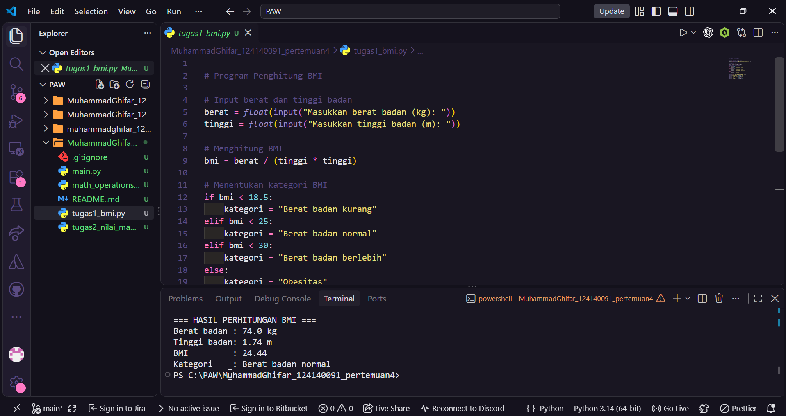
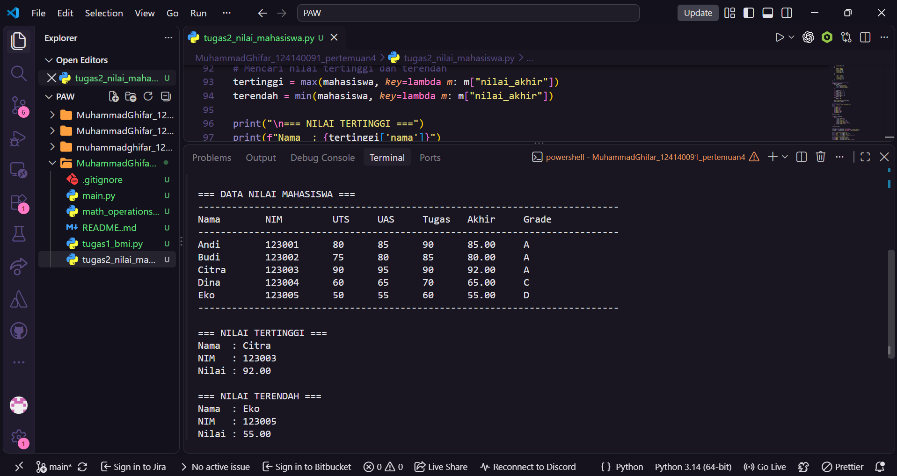
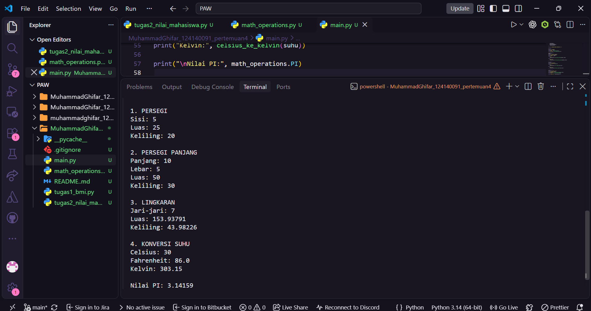

# Tugas Praktikum Dasar Pemrograman Python
## Pertemuan 4

### Identitas Mahasiswa
- Nama: Muhammad Ghifar
- NIM: 134140091
- Mata Kuliah: Dasar Pemrograman Python

---

## 1. Program Penghitung BMI

File: `tugas1_bmi.py`

Program ini digunakan untuk menghitung Body Mass Index (BMI)
berdasarkan berat dan tinggi badan pengguna.

Program menerima input berat badan dan tinggi badan,
menghitung BMI, kemudian menentukan kategori berat badan
menggunakan percabangan if-elif-else.

Cara menjalankan:
```bash
python tugas1_bmi.py
```

### Screenshot Hasil Eksekusi


---

## 2. Program Pengelolaan Nilai Mahasiswa

File: `tugas2_nilai_mahasiswa.py`

Program ini mengelola data minimal lima mahasiswa menggunakan
list dan dictionary.

Program menghitung nilai akhir berdasarkan bobot UTS, UAS,
dan tugas, menentukan grade, menampilkan tabel nilai,
serta mencari nilai tertinggi dan terendah.

Cara menjalankan:
```bash
python tugas2_nilai_mahasiswa.py
```

### Screenshot Hasil Eksekusi


---

## 3. Modul Matematika Python

File:
- `math_operations.py`
- `main.py`

Modul math_operations.py berisi fungsi perhitungan luas dan
keliling persegi, persegi panjang, dan lingkaran, serta
konversi suhu Celsius ke Fahrenheit dan Kelvin.

File main.py digunakan untuk mengimpor dan menguji seluruh
fungsi yang tersedia dalam modul.

Cara menjalankan:
```bash
python main.py
```

### Screenshot Hasil Eksekusi

