# Praktikum RESTful API menggunakan Pyramid

## Identitas Praktikan

| Keterangan | Informasi |
|---|---|
| Nama Lengkap | Muhammad Ghifar |
| NIM | 124140091 |
| Kelas Praktikum | RA |

## Deskripsi Aplikasi

Praktikum ini bertujuan untuk membangun aplikasi RESTful API menggunakan framework **Pyramid**, SQLAlchemy sebagai ORM, dan PostgreSQL sebagai sistem manajemen basis data.

Aplikasi ini mengelola dua entitas utama, yaitu **Mahasiswa** dan **Mata Kuliah**. Implementasi API mencakup operasi CRUD (Create, Read, Update, Delete), serta validasi input untuk memastikan data yang dikirimkan sesuai dengan ketentuan.

Pengujian endpoint dilakukan menggunakan cURL melalui terminal PowerShell.

## Teknologi yang Digunakan

- Python
- Pyramid Framework
- SQLAlchemy
- Alembic
- PostgreSQL
- psycopg2-binary
- cURL

## Instalasi dan Konfigurasi

### 1. Clone Repository

```bash
git clone <URL_REPOSITORY>
cd pyramid_mahasiswa
```

### 2. Membuat Virtual Environment

```bash
python -m venv venv
```

Aktifkan virtual environment pada Windows PowerShell:

```powershell
.\venv\Scripts\Activate.ps1
```

### 3. Instalasi Dependencies

Perbarui pip:

```bash
python -m pip install --upgrade pip
```

Instal dependencies proyek:

```bash
python -m pip install -e ".[testing]"
```

Instal driver PostgreSQL:

```bash
python -m pip install psycopg2-binary
```

### 4. Konfigurasi Database PostgreSQL

Buat database dan user PostgreSQL:

```sql
CREATE USER pyramid_user WITH ENCRYPTED PASSWORD 'pyramid_pass';
CREATE DATABASE pyramid_mahasiswa;
GRANT ALL PRIVILEGES ON DATABASE pyramid_mahasiswa TO pyramid_user;
```

Hubungkan ke database:

```sql
\c pyramid_mahasiswa
```

Berikan hak akses schema:

```sql
GRANT ALL ON SCHEMA public TO pyramid_user;
```

Sesuaikan konfigurasi koneksi database pada `development.ini` dengan database PostgreSQL yang telah dibuat.

### 5. Migrasi Database

Jalankan migrasi untuk membuat tabel berdasarkan model yang telah didefinisikan:

```powershell
alembic -c development.ini upgrade head
```

### 6. Inisialisasi Data Awal

Jalankan script inisialisasi database:

```powershell
python -m pyramid_mahasiswa.scripts.initialize_db development.ini
```

Script ini digunakan untuk memasukkan data awal mahasiswa ke dalam database. Data mata kuliah juga disiapkan sesuai implementasi seeding proyek.

### 7. Menjalankan Server

Jalankan aplikasi Pyramid menggunakan perintah:

```powershell
pserve development.ini --reload
```

Server berjalan pada alamat:

`http://localhost:6543`

## Dokumentasi Pengujian API

Seluruh pengujian dilakukan menggunakan cURL (`curl.exe`) melalui Windows PowerShell.

### A. API Mahasiswa

Endpoint utama:

`http://localhost:6543/api/mahasiswa`

| No. | Method | Endpoint | Keterangan |
|---|---|---|---|
| 1 | GET | `/api/mahasiswa` | Menampilkan seluruh mahasiswa |
| 2 | GET | `/api/mahasiswa/{id}` | Menampilkan detail mahasiswa |
| 3 | POST | `/api/mahasiswa` | Menambahkan mahasiswa |
| 4 | PUT | `/api/mahasiswa/{id}` | Memperbarui data mahasiswa |
| 5 | DELETE | `/api/mahasiswa/{id}` | Menghapus mahasiswa |

#### 1. GET Seluruh Mahasiswa

Menampilkan seluruh data mahasiswa yang tersimpan dalam database.

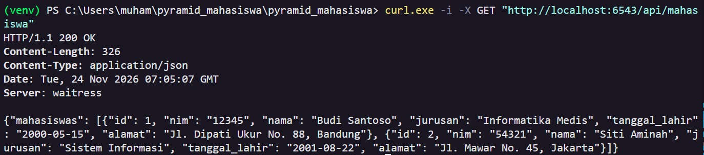

#### 2. GET Detail Mahasiswa

Menampilkan data mahasiswa berdasarkan ID.

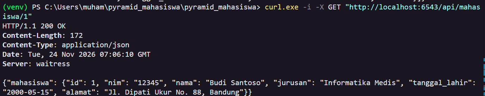

#### 3. POST Tambah Mahasiswa

Menambahkan data mahasiswa baru dengan mengirimkan JSON berisi NIM, nama, jurusan, tanggal lahir, dan alamat.

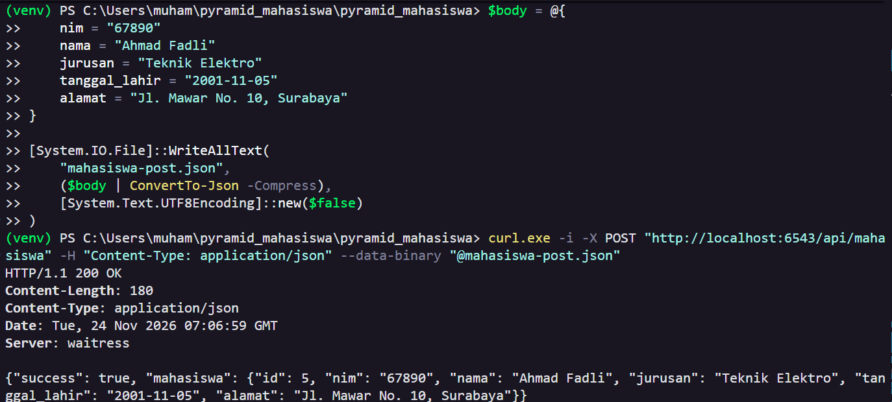

#### 4. PUT Update Mahasiswa

Memperbarui data mahasiswa berdasarkan ID.

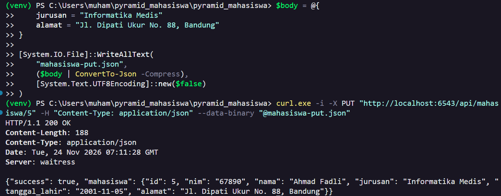

#### 5. DELETE Mahasiswa

Menghapus data mahasiswa berdasarkan ID.

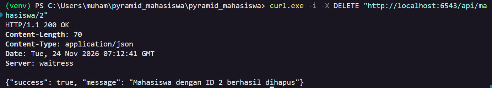

#### 6. GET Mahasiswa Tidak Ditemukan

Memastikan API memberikan respons ketika mahasiswa dengan ID tertentu tidak ditemukan.

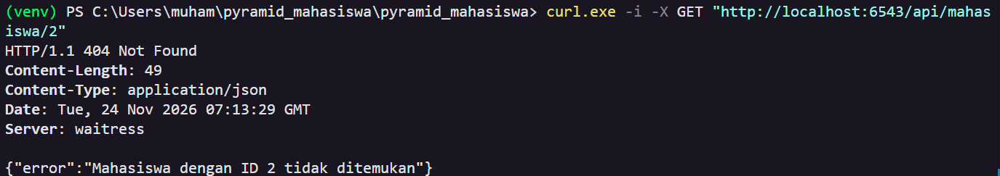

#### 7. Validasi NIM

Menguji validasi ketika NIM tidak diisi pada saat menambahkan mahasiswa.

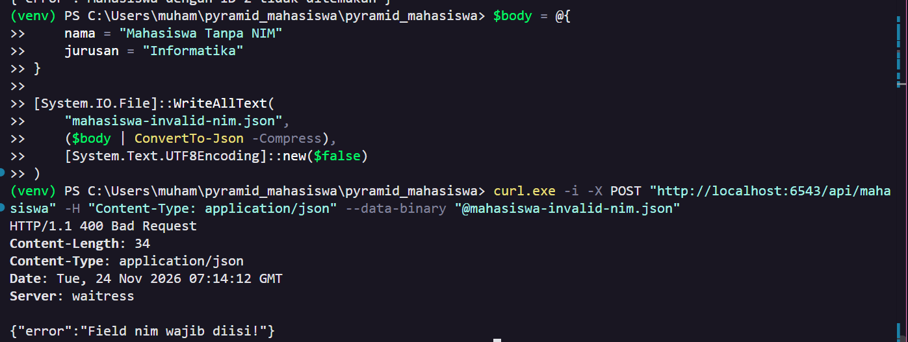

#### 8. Validasi Tanggal Lahir

Menguji validasi ketika format tanggal lahir tidak sesuai dengan format `YYYY-MM-DD`.

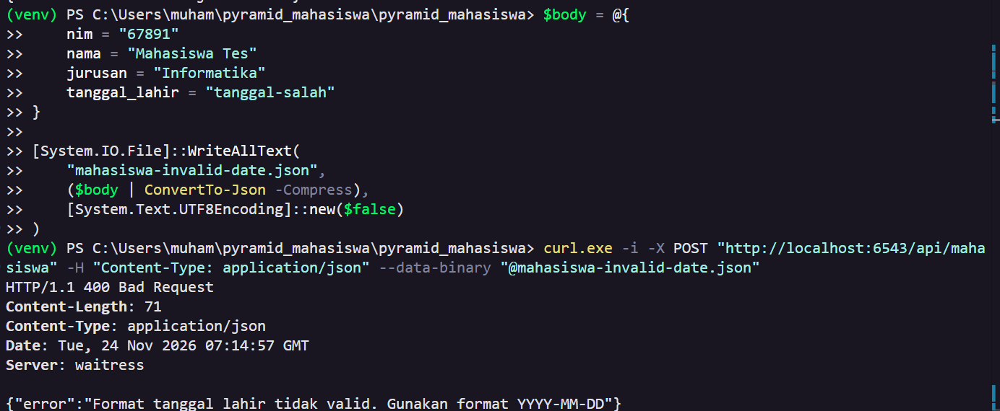

---

### B. API Mata Kuliah

Endpoint utama:

`http://localhost:6543/api/matakuliah`

| No. | Method | Endpoint | Keterangan |
|---|---|---|---|
| 1 | GET | `/api/matakuliah` | Menampilkan seluruh mata kuliah |
| 2 | GET | `/api/matakuliah/{id}` | Menampilkan detail mata kuliah |
| 3 | POST | `/api/matakuliah` | Menambahkan mata kuliah |
| 4 | PUT | `/api/matakuliah/{id}` | Memperbarui mata kuliah |
| 5 | DELETE | `/api/matakuliah/{id}` | Menghapus mata kuliah |

#### 1. GET Seluruh Mata Kuliah

Menampilkan seluruh data mata kuliah yang tersimpan dalam database.

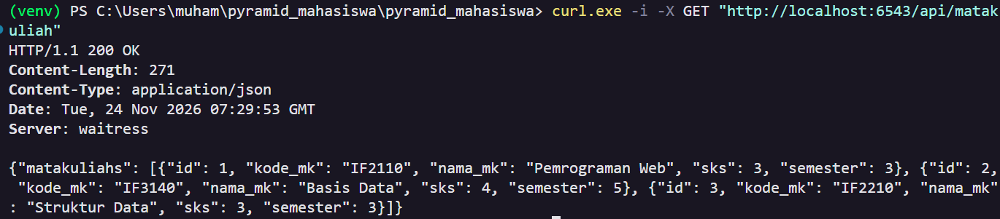

#### 2. GET Detail Mata Kuliah

Menampilkan data mata kuliah berdasarkan ID.

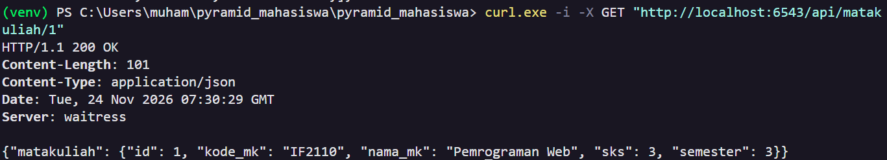

#### 3. POST Tambah Mata Kuliah

Menambahkan mata kuliah baru dengan mengirimkan kode mata kuliah, nama mata kuliah, SKS, dan semester.

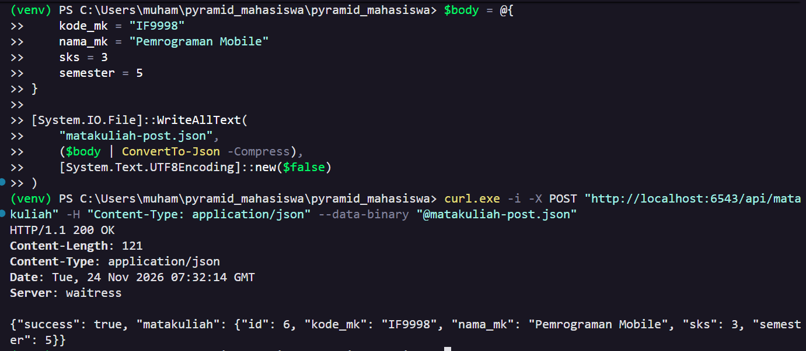

#### 4. PUT Update Mata Kuliah

Memperbarui data mata kuliah berdasarkan ID.

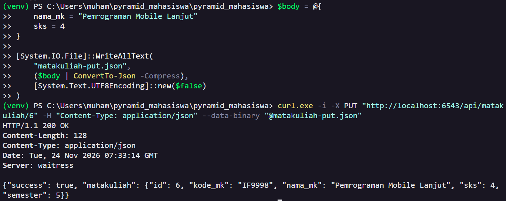

#### 5. DELETE Mata Kuliah

Menghapus data mata kuliah berdasarkan ID.

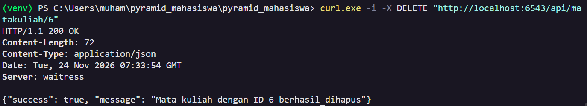

#### 6. GET Mata Kuliah Tidak Ditemukan

Memastikan API memberikan respons ketika mata kuliah dengan ID tertentu tidak ditemukan.

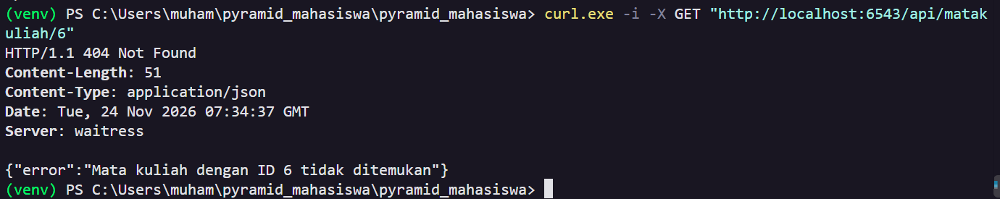

#### 7. Validasi Field Wajib

Menguji validasi ketika kode mata kuliah tidak diisi.

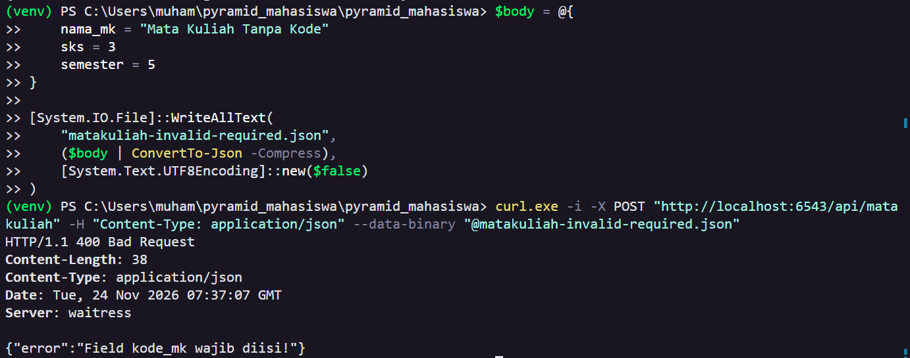

#### 8. Validasi Tipe Data

Menguji validasi ketika nilai SKS atau semester tidak menggunakan tipe data angka.

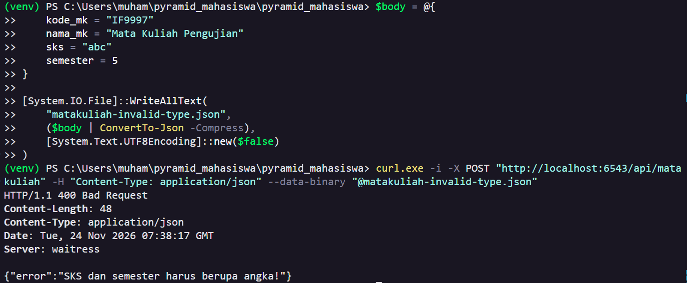

#### 9. Validasi Kode Mata Kuliah Duplikat

Menguji validasi ketika kode mata kuliah yang dimasukkan sudah digunakan oleh data lain.

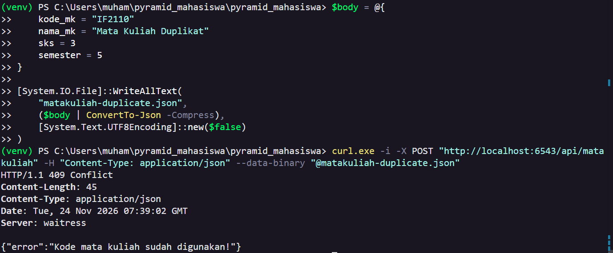

## Struktur Direktori Screenshot

```text
docs/
└── screenshots/
    ├── mahasiswa/
    │   ├── 01-get-all.png
    │   ├── 02-get-detail.png
    │   ├── 03-post-create.png
    │   ├── 04-put-update.png
    │   ├── 05-delete.png
    │   ├── 06-get-not-found.png
    │   ├── 07-validation-nim.png
    │   └── 08-validation-date.png
    │
    └── matakuliah/
        ├── 01-get-all.png
        ├── 02-get-detail.png
        ├── 03-post-create.png
        ├── 04-put-update.png
        ├── 05-delete.png
        ├── 06-get-not-found.png
        ├── 07-validation-required.png
        ├── 08-validation-type.png
        └── 09-validation-duplicate.png
```

## Pengelolaan File dan Git

Untuk menjaga kebersihan repositori, beberapa file dan direktori sementara tidak disertakan dalam Git.

Pastikan `.gitignore` memuat:

```gitignore
# Virtual Environment
venv/
.venv/
env/

# Python Cache
__pycache__/
*.py[cod]
*.pyc

# Database Lokal
*.sqlite
*.db

# Environment Variables
.env

# IDE
.vscode/
.idea/
```

Dengan demikian, repositori hanya menyimpan source code, konfigurasi yang diperlukan, dokumentasi, dan bukti pengujian.

## Kesimpulan

Melalui praktikum ini, berhasil dikembangkan aplikasi RESTful API menggunakan Pyramid Framework dengan PostgreSQL sebagai basis data. Aplikasi menyediakan operasi CRUD untuk pengelolaan data mahasiswa dan mata kuliah, dilengkapi validasi input serta penanganan kondisi ketika data tidak ditemukan.

Pengujian dilakukan menggunakan cURL untuk memastikan setiap endpoint dapat berjalan sesuai dengan fungsinya.
