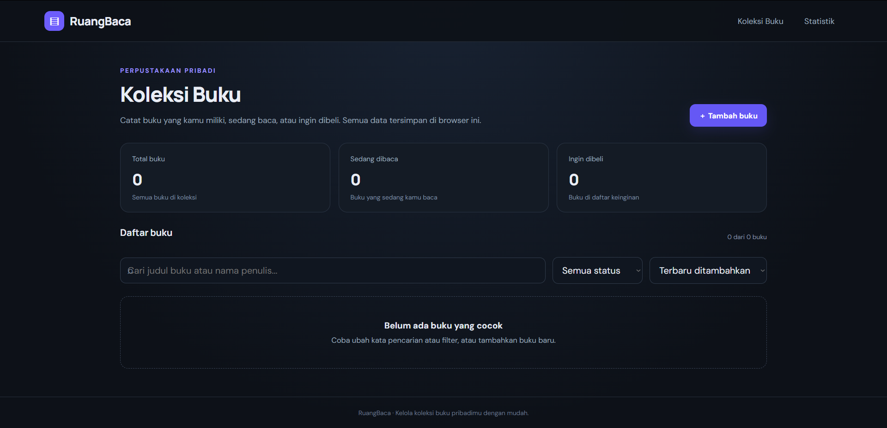
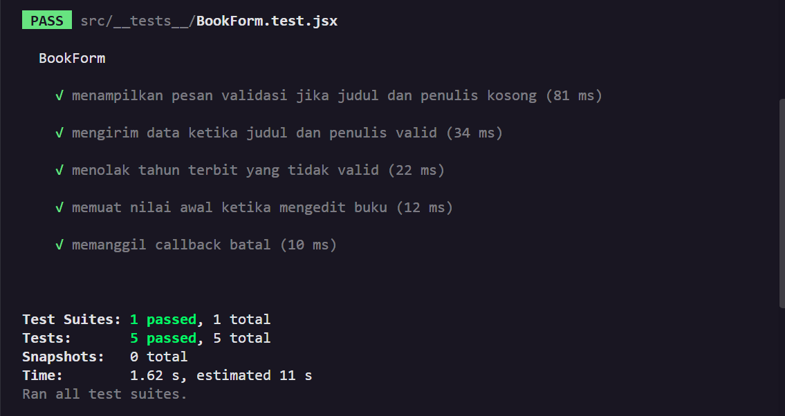
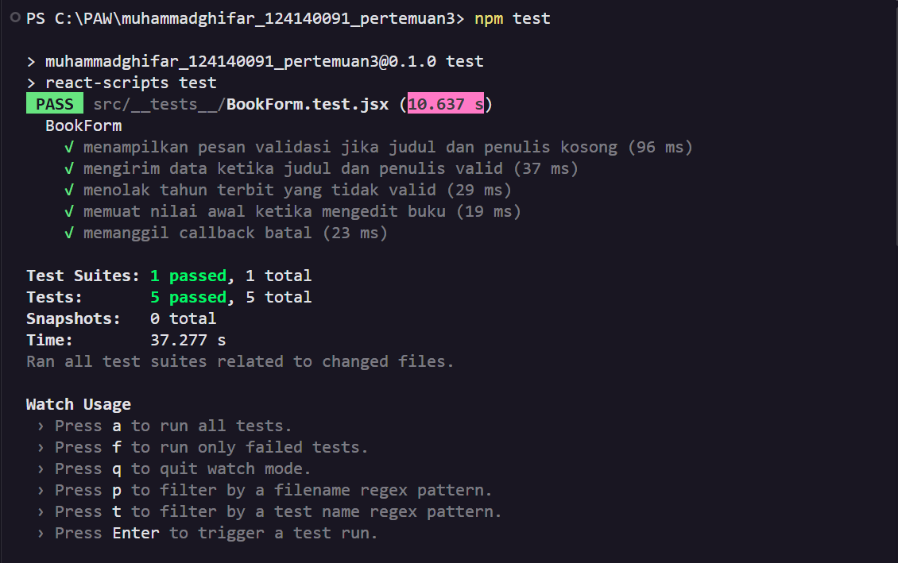

# Aplikasi Manajemen Buku Pribadi

## 1. Deskripsi Aplikasi

Aplikasi Manajemen Buku Pribadi merupakan aplikasi berbasis web yang dibuat menggunakan React untuk membantu pengguna mencatat dan mengelola koleksi buku pribadi.

Pengguna dapat menambahkan buku, mengedit informasi buku, menghapus buku, mencari buku berdasarkan judul atau nama penulis, serta memfilter buku berdasarkan statusnya.

Data buku disimpan menggunakan `localStorage`, sehingga data tetap tersedia ketika halaman dimuat ulang selama data browser tidak dihapus.

## 2. Teknologi yang Digunakan

- **React** untuk membangun antarmuka aplikasi.
- **JavaScript** untuk logika aplikasi.
- **CSS** untuk mengatur tampilan aplikasi.
- **React Router** untuk navigasi antarhalaman.
- **React Context API** untuk membagikan data buku ke beberapa komponen.
- **React Hooks** untuk mengelola state dan efek pada komponen.
- **localStorage** untuk menyimpan data buku di browser.
- **React Testing Library** untuk membantu pengujian komponen.

## 3. Fitur Aplikasi

Aplikasi ini memiliki beberapa fitur utama:

1. **Tambah Buku**  
   Menambahkan buku baru dengan informasi judul, penulis, status, tahun terbit, genre, dan catatan.

2. **Edit Buku**  
   Mengubah informasi buku yang sudah tersimpan.

3. **Hapus Buku**  
   Menghapus buku dari koleksi dengan konfirmasi sebelum penghapusan.

4. **Pencarian Buku**  
   Mencari buku berdasarkan judul atau nama penulis.

5. **Filter Status Buku**  
   Menampilkan buku berdasarkan status:
   - Milik saya
   - Sedang dibaca
   - Ingin dibeli

6. **Pengurutan Buku**  
   Mengurutkan buku berdasarkan waktu penambahan, judul, atau nama penulis.

7. **Statistik Buku**  
   Menampilkan jumlah buku, jumlah penulis berbeda, distribusi status buku, dan daftar buku terbaru.

8. **Penyimpanan Data**  
   Menyimpan data secara lokal menggunakan `localStorage`.

9. **Validasi Formulir**  
   Memastikan judul dan penulis diisi serta tahun terbit menggunakan format yang valid jika dicantumkan.

## 4. Struktur Folder

Struktur folder utama di dalam `src` adalah sebagai berikut:

```text
src/
├── components/
│   ├── BookForm/
│   │   ├── BookForm.jsx
│   │   └── BookForm.css
│   ├── BookList/
│   │   ├── BookList.jsx
│   │   └── BookList.css
│   └── BookFilter/
│       ├── BookFilter.jsx
│       └── BookFilter.css
├── pages/
│   ├── Home/
│   │   ├── Home.jsx
│   │   └── Home.css
│   └── Stats/
│       ├── Stats.jsx
│       └── Stats.css
├── hooks/
│   ├── useLocalStorage.js
│   └── useBookStats.js
├── context/
│   └── BookContext.jsx
├── App.jsx
├── index.js
└── styles.css
```

## 5. Instalasi dan Cara Menjalankan Aplikasi

### Persyaratan

Pastikan Node.js dan npm sudah terpasang pada komputer.

### Langkah Instalasi

1. Buka folder proyek menggunakan Visual Studio Code.
2. Buka terminal pada folder utama proyek.
3. Jalankan perintah berikut untuk memasang dependency:

   ```bash
   npm install
   ```

4. Jalankan aplikasi menggunakan perintah:

   ```bash
   npm start
   ```

5. Buka browser dan akses alamat berikut:

   ```text
   http://localhost:3000
   ```

### Menjalankan Unit Test

Untuk menjalankan pengujian, gunakan perintah:

```bash
npm test
```

Create React App akan menjalankan test dalam mode interaktif. Tekan `a` pada terminal jika ingin menjalankan seluruh test yang tersedia.

### Membuat Build Aplikasi

Untuk membuat versi produksi, jalankan:

```bash
npm run build
```

Hasil build akan disimpan dalam folder `build`.

## 6. Screenshot Antarmuka Aplikasi

Tambahkan screenshot aplikasi yang sudah dijalankan pada bagian ini.

### Halaman Koleksi Buku



Halaman ini menampilkan daftar buku, informasi jumlah buku, fitur pencarian, filter status, serta tombol untuk menambah, mengedit, dan menghapus buku.

## 7. Penjelasan Konsep React yang Digunakan

### a. Functional Components

Komponen aplikasi dibuat menggunakan function JavaScript, seperti `BookForm`, `BookList`, `BookFilter`, `Home`, dan `Stats`. Setiap komponen memiliki tanggung jawab tertentu agar kode lebih mudah dipahami dan dikelola.

### b. useState

`useState` digunakan untuk menyimpan dan mengubah state, seperti data formulir, kata pencarian, filter status, serta kondisi tampil atau tidaknya formulir.

### c. useEffect

`useEffect` digunakan pada custom hook `useLocalStorage` untuk menyimpan perubahan data ke browser. Hook ini juga digunakan pada formulir untuk mengatur nilai awal ketika data buku yang diedit berubah.

### d. Props

Props digunakan untuk mengirim data dan fungsi dari komponen induk ke komponen anak. Contohnya, `BookList` menerima daftar buku dan fungsi untuk mengedit atau menghapus buku.

### e. Context API

`BookContext` digunakan untuk membagikan data buku dan fungsi pengelolaannya ke komponen yang membutuhkan, sehingga data tidak perlu diteruskan melalui banyak tingkat props.

### f. Custom Hooks

Aplikasi memiliki dua custom hooks:

- `useLocalStorage` untuk mengelola state yang disimpan di browser.
- `useBookStats` untuk menghitung statistik buku berdasarkan data koleksi.

### g. React Router

React Router digunakan untuk mengatur navigasi antara halaman Koleksi Buku dan Statistik Buku tanpa perlu membuat halaman HTML terpisah.

### h. Conditional Rendering

Conditional rendering digunakan untuk menampilkan pesan ketika daftar buku kosong, menampilkan formulir hanya ketika diperlukan, serta menampilkan pesan kesalahan saat input tidak valid.

### i. Rendering Daftar dengan map()

Method `map()` digunakan untuk menampilkan kumpulan buku dalam bentuk kartu. Setiap kartu menggunakan `id` sebagai key agar React dapat mengidentifikasi elemen daftar.

### j. useMemo

`useMemo` digunakan untuk membantu menghitung statistik dan memproses daftar buku yang sudah dicari, difilter, atau diurutkan ketika data atau kriteria berubah.

## 8. Pengujian Aplikasi

Pengujian dilakukan menggunakan Jest yang tersedia melalui Create React App dan React Testing Library.

Pengujian komponen formulir mencakup:

1. Memastikan judul dan penulis wajib diisi.
2. Memastikan data dikirim ketika input valid.
3. Memastikan tahun terbit yang tidak valid ditolak.
4. Memastikan formulir memuat data awal ketika mengedit buku.
5. Memastikan tombol batal memanggil fungsi pembatalan.

### Bukti Eksekusi Unit Test

Jalankan perintah berikut pada terminal:

```bash
npm test
```

Ambil screenshot terminal yang menunjukkan hasil pengujian. Simpan gambar tersebut sebagai:

```text
docs/screenshots/hasil-unit-test.png
```

Kemudian tampilkan bukti tersebut di bawah ini:




## 9. Kesimpulan

Aplikasi Manajemen Buku Pribadi menerapkan konsep dasar React untuk membangun aplikasi yang memiliki beberapa komponen, pengelolaan state, navigasi halaman, penyimpanan data lokal, dan pengujian komponen.

Dengan pemisahan komponen, hooks, dan context, kode aplikasi menjadi lebih terstruktur serta lebih mudah dipahami dan dikembangkan.
